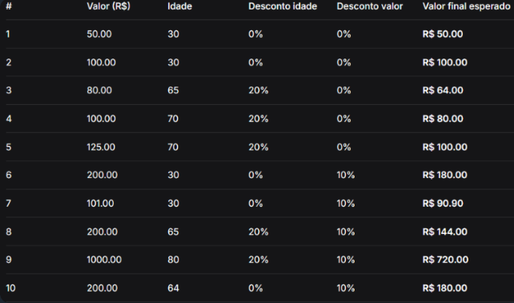

# Desafio Nível 1 — PDV com Descontos

## 1. O que o código faz

Este projeto implementa um sistema de Ponto de Venda (PDV) em Python que calcula descontos progressivos nas compras. O programa aplica 20% de desconto para clientes com idade igual ou superior a 65 anos e, depois, aplica um desconto adicional de 10% quando o valor da compra, após o desconto por idade, é superior a R$ 100,00. O sistema permite registrar várias compras, armazena os dados em uma lista e apresenta um resumo final com a quantidade de compras, o valor total bruto, os descontos concedidos e o valor total final.

## 2. Como o código funciona

1. **Entrada de dados:** solicita o valor da compra em reais e a idade do cliente.
2. **Validação:** verifica se o valor da compra ou a idade são negativos. Caso sejam, exibe uma mensagem de aviso e solicita novamente a entrada.
3. **Desconto por idade:** verifica se o cliente tem 65 anos ou mais. Se tiver, aplica 20% de desconto sobre o valor original.
4. **Desconto por valor:** verifica se o valor após o desconto por idade é superior a R$ 100,00. Se for, aplica mais 10% sobre esse valor reduzido.
5. **Registro da compra:** utiliza o método `.append()` para armazenar em uma lista o valor original, o desconto total e o valor final de cada compra.
6. **Repetição:** utiliza um laço `while` para permitir várias compras. O programa encerra quando o usuário digita `0` no campo do valor da compra.
7. **Resumo do dia:** utiliza `len()` para contar as compras e um laço `for` com acumuladores para somar os valores originais, os descontos e os valores finais.
8. **Exibição dos resultados:** apresenta os valores monetários formatados com duas casas decimais.

## 3. Como executar

Abra o terminal na pasta `nivel_1` e execute:

python pdv.py

Para encerrar as operações e visualizar o resumo do dia, digite `0` no valor da próxima compra.

## 4. Tabela de exemplos e casos de teste

## 5. Conceitos de Python praticados

- `input()` para receber dados do usuário.
- `float()` e `int()` para converter entradas numéricas.
- `if` para implementar regras de negócio.
- `while` para repetir operações e validar entradas.
- Listas para armazenar o histórico das compras.
- `.append()` para adicionar registros à lista.
- `for` para percorrer o histórico.
- `len()` para contar a quantidade de compras.
- Acumuladores para calcular totais.
- F-strings e `:.2f` para formatar valores monetários.

---

**Projeto:** Desafio Nível 1 — PDV com Descontos  
**Linguagem:** Python  

